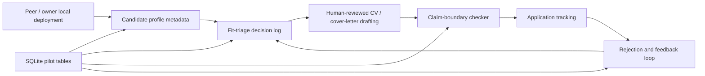

# Private Pilot Architecture and Privacy Notes

## Architecture summary

## Local-first design

JobOps remains single-instance and local-first by default. The private pilot layer is a registry and workflow evidence layer, not a full multi-tenant hosted SaaS.

Current pilot tables:

- `pilot_users` — local-deployment users or demo users.
- `pilot_user_profiles` — lightweight profile metadata and guardrails.
- `pilot_feedback_notes` — anonymized product/feedback/rejection notes.
- `pilot_application_reviews` — fit-triage decisions, optionally linked to an application.
- `pilot_claim_checks` — claim-boundary checks, optionally linked to an application.

## Privacy stance

Default peer-user mode is `local_only`:

- friends can run their own local instance;
- full CV/application data does not need to be imported into Jiajia's database;
- feedback can be recorded as anonymized notes;
- email/contact information is optional and should only be stored with consent.

## Human-in-the-loop AI workflow

The project deliberately avoids autonomous application submission. The intended workflow is:

1. Capture a job.
2. Record fit decision.
3. Draft materials with AI assistance.
4. Check claim boundaries.
5. User reviews and submits manually.
6. Track outcome and rejection signals.

## Boundaries for CV/interview claims

Safe claims:

- private invite-only pilot;
- local-first peer deployments;
- profile metadata and guardrail design;
- fit-triage workflow;
- claim-boundary checker;
- anonymized feedback loop;
- Docker/SQLite/TypeScript/React/Express implementation.

Do not claim unless later implemented and verified:

- commercial SaaS;
- paid customers;
- production multi-tenant hosting;
- enterprise-scale usage;
- autonomous application submission;
- storing friends' sensitive data in a shared hosted database.
